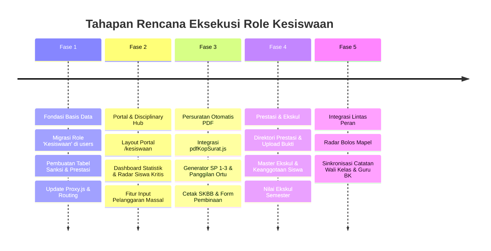

# 🛡️ Desain & Rencana Implementasi: Role Kesiswaan (Guru App)

> **Dokumen Teknis:** Rekomendasi Arsitektur, Skema Database, Hak Akses (RBAC), dan Rencana Implementasi Portal Kesiswaan.  
> **Target Pengguna:** Wakasek Kesiswaan, Tim Ketertiban (Tatib), Pembina OSIS, dan Staf Kesiswaan Sekolah.  
> **Status:** 📋 Rancangan Siap Eksekusi (Ready for Implementation)

---

## Daftar Isi

1. [Latar Belakang & Filosofi Peran](#1-latar-belakang--filosofi-peran)
2. [Analisis Kebutuhan & Perbandingan Peran](#2-analisis-kebutuhan--perbandingan-peran)
3. [Arsitektur Sistem & Diagram Alur](#3-arsitektur-sistem--diagram-alur)
4. [Daftar Fitur & Modul Portal Kesiswaan (`/kesiswaan/*`)](#4-daftar-fitur--modul-portal-kesiswaan-kesiswaan)
5. [Matriks Otorisasi & Hak Akses (RBAC)](#5-matriks-otorisasi--hak-akses-rbac)
6. [Perubahan Skema Database](#6-perubahan-skema-database)
7. [Perubahan Middleware & Routing (`src/proxy.js`)](#7-perubahan-middleware--routing-srcproxyjs)
8. [Rencana Endpoint API Baru (`/api/kesiswaan/*`)](#8-rencana-endpoint-api-baru-apikesiswaan)
9. [Desain Antarmuka (UI/UX Neobrutalism)](#9-desain-antarmuka-uiux-neobrutalism)
10. [Rencana Pentahapan Implementasi (Roadmap)](#10-rencana-pentahapan-implementasi-roadmap)

---

## 1. Latar Belakang & Filosofi Peran

Dalam struktur operasional satuan pendidikan (SMP, SMA, SMK, MTs, MA), **Bidang Kesiswaan** (Wakil Kepala Sekolah Bidang Kesiswaan / Tim Ketertiban / Pembina OSIS) memegang peran vital di luar ranah akademik murni. Kesiswaan bertanggung jawab atas:

1. **Penegakan Tata Tertib & Kedisiplinan:** Mengontrol perilaku, menindak pelanggaran, memantau akumulasi poin minus, dan memberikan pembinaan bertingkat (lisan, tertulis/SP, pemanggilan orang tua, hingga skorsing).
2. **Pengembangan Bakat & Prestasi Siswa:** Mendokumentasikan pencapaian siswa dalam ajang perlombaan akademik maupun non-akademik (OSN, O2SN, FLS2N, seni, olahraga, dan keagamaan), serta memverifikasi pemberian poin reward/apresiasi.
3. **Pengawasan Presensi Makro & Deteksi Bolos:** Memantau kehadiran siswa lintas kelas, mendeteksi siswa yang membolos jam pelajaran tertentu (bolos mapel), serta memantau siswa yang sering tidak hadir (alfa) berturut-turut.
4. **Organisasi Siswa & Ekstrakurikuler:** Mengoordinasikan kepengurusan OSIS/MPK, pendaftaran dan keikutsertaan kegiatan ekstrakurikuler, serta pembina ekskul.
5. **Persuratan Resmi Kesiswaan:** Menerbitkan Surat Peringatan (SP 1, SP 2, SP 3), Surat Panggilan Orang Tua/Wali Murid, Surat Perjanjian Disiplin, dan Surat Keterangan Berkelakuan Baik (SKBB) dengan kop resmi sekolah.

---

## 2. Analisis Kebutuhan & Perbandingan Peran

Sebelum merancang role Kesiswaan, penting membedakan batas kewenangan Kesiswaan dengan peran-peran lain yang sudah ada:

| Aspek | Guru Mapel | Wali Kelas | Guru BK | Kesiswaan (Baru) | Kepala Sekolah |
| :--- | :--- | :--- | :--- | :--- | :--- |
| **Ruang Lingkup** | Rombel & mapel yang diajar | 1 Kelas binaan | Seluruh siswa | **Seluruh siswa & seluruh kelas** | Seluruh sekolah |
| **Fokus Utama** | Pembelajaran & penilaian KBM | Performa akademik & presensi kelas | Konseling psikologis & pemulihan pribadi | **Ketertiban, sanksi, prestasi, & ekskul** | Supervisi eksekutif institusi |
| **Poin Perilaku** | Input poin saat jam pelajaran | Input & pantau poin kelas binaan | Input poin & catatan konseling | **Input massal (razia/tatib), verifikasi, & sanksi** | Monitoring rekapitulasi poin |
| **Penerbitan Sanksi/Surat** | ❌ Tidak berwenang | Rekomendasi pembinaan internal kelas | Rekomendasi rujukan konseling | **✅ Penerbitan resmi SP1, SP2, SP3 & panggilan ortu** | Mengetahui/menyetujui sanksi berat |
| **Mutasi/Aksi Data** | Input nilai & jurnal KBM | Sahkan presensi harian rombel | Input catatan konseling | **Eskalasi kasus, manajemen ekskul, & rekor prestasi** | ❌ Read-Only (hanya pantau) |

### Pilihan Model Akun: Dedicated Role vs Dual Role

* **Kondisi Realita Sekolah:** Di sebagian besar sekolah, Wakasek Kesiswaan atau Pembina Kesiswaan adalah seorang **Guru** yang mendapat tugas tambahan (*Tugas Tambahan Kesiswaan*). Namun di beberapa sekolah besar, ada staf tata usaha/kepegawaian khusus yang didedikasikan sebagai Staf Kesiswaan murni tanpa mengajar.
* **Solusi Arsitektur Terbaik (Hybrid Flexible):**
  1. **Primary Role (`role = 'Kesiswaan'`):** Untuk staf/pembina yang murni beroperasi di portal kesiswaan `/kesiswaan`.
  2. **Multi-Role / Switcher Capability:** Bagi Guru yang merangkap sebagai Tim Kesiswaan, akun `role = 'Guru'` dapat diberikan penugasan kesiswaan di database sehingga muncul shortcut switcher *"Buka Portal Kesiswaan"* di beranda.

---

## 3. Arsitektur Sistem & Diagram Alur

```mermaid
flowchart TD
    Login([Pengguna Login]) --> Proxy[Middleware / Proxy.js]
    Proxy --> CheckRole{Cek Role Pengguna}
    
    CheckRole -->|Admin| AdminDash[/admin]
    CheckRole -->|Kepala Sekolah| KepsekDash[/kepsek]
    CheckRole -->|Bendahara| BendaharaDash[/bendahara]
    CheckRole -->|Guru| GuruHome[/]
    CheckRole -->|Kesiswaan| KesiswaanPortal[/kesiswaan]

    subgraph Portal Kesiswaan [/kesiswaan/*]
        KesiswaanPortal --> Modul1["📊 1. Dashboard & Radar Disiplin Real-time"]
        KesiswaanPortal --> Modul2["⚖️ 2. Hub Disiplin & Pelanggaran (SP 1-3)"]
        KesiswaanPortal --> Modul3["🏆 3. Direktori Prestasi & Apresiasi"]
        KesiswaanPortal --> Modul4["📡 4. Radar Absensi & Deteksi Bolos"]
        KesiswaanPortal --> Modul5["⛺ 5. Manajemen Ekskul & OSIS"]
        KesiswaanPortal --> Modul6["📝 6. Generator Persuratan Resmi (PDF)"]
        KesiswaanPortal --> Modul7["👤 7. Direktori Siswa 360°"]
    end

    Modul2 -.->|Poin Pelanggaran Ekstrem| Modul6
    Modul4 -.->|Siswa Sering Bolos| Modul2
    Modul3 -.->|Reward Poin Positif| PoinDB[(Tabel Poin)]
    Modul6 -.->|Gunakan Kop Surat| PDFLib[pdfKopSurat.js]
```

---

## 4. Daftar Fitur & Modul Portal Kesiswaan (`/kesiswaan/*`)

### 4.1. Modul 1: Dashboard Kesiswaan & Early Warning Radar (`/kesiswaan`)
* **Metric Cards Utama:**
  * Total Siswa Aktif Sekolah & Rasio Gender (L/P).
  * Tingkat Kehadiran Sekolah Hari Ini (% hadir, total sakit, izin, alfa, terlambat).
  * Kasus Pelanggaran Baru (7 hari terakhir).
  * Siswa Status Siaga / Kritis (akumulasi poin mendekati atau melampaui batas SP).
  * Prestasi Terverifikasi Semester Ini.
* **Early Warning Radar:**
  * Widget daftar siswa dengan akumulasi poin negatif tertinggi (Top 10 Pelanggar).
  * Widget siswa bolos jam KBM hari ini (tercatat tidak hadir di sesi mapel padahal hadir di gerbang/sesi awal).
  * Widget agenda upacara/pembinaan dan pemanggilan wali murid yang terjadwal minggu ini.

### 4.2. Modul 2: Hub Disiplin & Pelanggaran (`/kesiswaan/pelanggaran`)
* **Pencatatan Pelanggaran Fleksibel:**
  * Input satuan atau **Quick Mass-Tagging** (misal: razia seragam kelas 8A atau razia razia handphone massal pada 15 siswa sekaligus).
  * Kategori pelanggaran berbobot: Ringan (-5 s/d -15), Sedang (-20 s/d -40), Berat (-50 s/d -100).
* **Alur Penegakan Sanksi Bertingkat (Automated Escalation Rule):**
  * `0 - 24 Poin Minus`: Pembinaan Mandiri oleh Wali Kelas.
  * `25 - 49 Poin Minus`: Peringatan Lisan Kesiswaan + Surat Teguran.
  * `50 - 74 Poin Minus`: **Surat Peringatan 1 (SP 1)** + Pemanggilan Orang Tua ke-1.
  * `75 - 99 Poin Minus`: **Surat Peringatan 2 (SP 2)** + Pemanggilan Orang Tua ke-2 + Skorsing 3 Hari.
  * `≥ 100 Poin Minus`: **Surat Peringatan 3 (SP 3)** + Konferensi Kasus (Kepsek, Kesiswaan, BK, Wali Kelas, Orang Tua).
* **Buku Kasus Digital & Tindak Lanjut:**
  * Catatan kronologi kejadian, saksi/guru pelapor, barang bukti foto/dokumen, bentuk sanksi pembinaan yang diberikan (misal: bakti sosial, membaca buku di perpus, pembersihan mushola), serta status kasus (*Open*, *Dalam Pembinaan*, *Tuntas/Resolved*).

### 4.3. Modul 3: Portofolio Prestasi & Apresiasi (`/kesiswaan/prestasi`)
* **Pendataan Prestasi Terstruktur:**
  * Nama ajang/kegiatan lomba.
  * Kategori: Akademik (Sains, Bahasa, Riset), Olahraga, Seni & Budaya, Keagamaan (Tahfidz, MTQ), Kepemimpinan/Pramuka.
  * Tingkat: Kecamatan, Kabupaten/Kota, Provinsi, Nasional, Internasional.
  * Juara / Peringkat: Juara 1, 2, 3, Harapan, Finalis, Peserta Terbaik.
  * Guru Pembimbing / Pelatih.
  * Unggah bukti sertifikat/piagam (disimpan di Supabase Storage).
* **Integrasi Poin Reward:**
  * Otomatis memberikan poin reward positif ke akun siswa (misal Juara 1 Kab = +30 poin, Juara 1 Nasional = +100 poin).
* **Cetak Sertifikat Apresiasi & Ekspor Laporan:**
  * Generate piagam penghargaan dari sekolah untuk siswa berprestasi.
  * Ekspor rekapitulasi data prestasi untuk keperluan Akreditasi Sekolah dan Laporan Dinas Pendidikan.

### 4.4. Modul 4: Radar Absensi Sekolah & Deteksi Bolos (`/kesiswaan/absensi`)
* **Live Overview Kehadiran Sekolah:**
  * Visualisasi kehadiran per tingkat (Kelas 7, Kelas 8, Kelas 9) dan per rombel.
* **Radar Bolos Jam Mata Pelajaran (Cross-Session Audit):**
  * Membandingkan data `absensi_harian` wali kelas dengan `absensi_mapel` guru KBM.
  * Mengidentifikasi siswa yang hadir pada pagi hari, namun "Alfa" pada jam ke-5 atau jam ke-7 (indikasi bolos cabut sekolah).
* **Daftar Siswa Kronis Absen:**
  * Siswa dengan Alfa $\ge 3$ hari berturut-turut atau akumulasi izin/sakit abnormal untuk tindak lanjut *Home Visit* (Kunjungan Rumah).

### 4.5. Modul 5: Manajemen Ekstrakurikuler & OSIS (`/kesiswaan/ekskul`)
* **Master Ekstrakurikuler:**
  * Daftar ekskul aktif (Pramuka, PMR, Futsal, Tari, Robotika, Jurnalistik, English Club, dll).
  * Penunjukan Guru Pembina Ekskul & Pelatih Luar.
  * Jadwal latihan rutin (hari, jam, lokasi).
* **Keanggotaan & Kehadiran Ekskul:**
  * Plotting anggota siswa per ekskul.
  * Pembina ekskul dapat mencatat presensi kehadiran kegiatan ekskul.
  * Catatan nilai ekskul untuk dicantumkan pada Rapor semester.
* **Organisasi Siswa (OSIS & MPK):**
  * Struktur kepengurusan, periode masa jabatan, dan agenda kerja kegiatan kesiswaan tahunan.

### 4.6. Modul 6: Generator Persuratan Resmi Kesiswaan (`/kesiswaan/surat`)
Terintegrasi langsung dengan helper `drawKopSuratPDF` dari [`src/lib/pdfKopSurat.js`](file:///c:/Copy/Local%20Disk%20%28H%29/Project/Website/antigravity/guru-app/src/lib/pdfKopSurat.js):
* **Surat Peringatan Siswa (SP 1, SP 2, SP 3):**
  * Format standar baku kedinasan dengan nomor surat otomatis, identitas siswa, rincian pasal pelanggaran/kronologi, dan tanda tangan Kesiswaan + Kepala Sekolah.
* **Surat Panggilan Orang Tua / Wali Murid:**
  * Penjadwalan tanggal dan jam menghadap ke ruang Kesiswaan/BK.
* **Surat Pernyataan / Perjanjian Disiplin Siswa:**
  * Template surat kesanggupan menaati tata tertib bertanda tangan siswa, orang tua, dan bermaterai.
* **Surat Keterangan Berkelakuan Baik (SKBB):**
  * Penerbitan cepat bagi siswa untuk keperluan beasiswa, mutasi, atau pendaftaran jenjang berikutnya.

### 4.7. Modul 7: Direktori Siswa 360° (`/kesiswaan/siswa`)
* Pencarian cepat seluruh siswa di seluruh kelas.
* Riwayat komprehensif perilaku siswa (*Student Conduct Timeline*):
  * Akumulasi Poin Bersih (Positif vs Negatif).
  * Histori seluruh catatan pelanggaran & sanksi.
  * Histori seluruh prestasi yang pernah diraih.
  * Histori absensi dan ekskul yang diikuti.
  * Tombol WhatsApp langsung ke nomor wali murid untuk koordinasi cepat.

---

## 5. Matriks Otorisasi & Hak Akses (RBAC)

| Modul / Fitur | Guru Biasa | Wali Kelas | Guru BK | Kesiswaan | Kepala Sekolah | Admin |
| :--- | :---: | :---: | :---: | :---: | :---: | :---: |
| Akses Portal `/kesiswaan/*` | ❌ | ❌ | 👁️ Pantau | ✅ **Full** | 👁️ Pantau | ✅ **Full** |
| Input Poin Pelanggaran Semua Kelas | ❌ (Hanya KBM) | ❌ (Hanya Rombel) | ✅ | ✅ | ❌ | ✅ |
| Terbitkan Surat Peringatan (SP 1-3) | ❌ | ❌ | ❌ | ✅ | 👁️ Mengetahui | ✅ |
| Terbitkan Panggilan Orang Tua | ❌ | Rekomendasi | ✅ Rekomendasi | ✅ Resmi | 👁️ Pantau | ✅ |
| Kelola Master Ekskul & Pembina | ❌ | ❌ | ❌ | ✅ | 👁️ Pantau | ✅ |
| Catat & Verifikasi Prestasi Siswa | ❌ | Input Draf | ❌ | ✅ Verifikasi | 👁️ Pantau | ✅ |
| Pantau Radar Bolos Seluruh Sekolah | ❌ | Kelasnya saja | ✅ | ✅ | 👁️ Pantau | ✅ |
| Cetak SKBB & Surat Kesiswaan (PDF) | ❌ | ❌ | ❌ | ✅ | 👁️ Mengetahui | ✅ |

---

## 6. Perubahan Skema Database

### 6.1. Update Check Constraint di Tabel `public.users`

Tambahkan nilai `'Kesiswaan'` ke dalam daftar role yang valid:

```sql
-- Migrasi Penambahan Role Kesiswaan
ALTER TABLE public.users DROP CONSTRAINT IF EXISTS users_role_check;

ALTER TABLE public.users ADD CONSTRAINT users_role_check 
CHECK (role IN ('Admin', 'Guru', 'Kepala Sekolah', 'Bendahara', 'Kesiswaan'));
```

### 6.2. Tabel Pendukung Kesiswaan

```sql
-- 1. TABEL SURAT PERINGATAN & SANKSI KESISWAAN
CREATE TABLE IF NOT EXISTS public.kesiswaan_sanksi (
    id SERIAL PRIMARY KEY,
    no_surat VARCHAR(100) UNIQUE,
    siswa_id TEXT NOT NULL REFERENCES public.siswa(id) ON DELETE CASCADE,
    jenis_sanksi VARCHAR(50) NOT NULL, -- 'SP1', 'SP2', 'SP3', 'Teguran', 'Skorsing', 'Panggilan Ortu'
    alasan TEXT NOT NULL,
    akumulasi_poin_saat_terbit INT DEFAULT 0,
    tanggal_terbit DATE NOT NULL DEFAULT CURRENT_DATE,
    tanggal_panggilan DATE, -- jika ada pemanggilan ortu
    batas_waktu_skorsing DATE, -- jika skorsing
    status_penyelesaian VARCHAR(30) DEFAULT 'Menunggu' CHECK (status_penyelesaian IN ('Menunggu', 'Dalam Pembinaan', 'Selesai', 'Dibatalkan')),
    tindak_lanjut TEXT,
    diterbitkan_oleh TEXT REFERENCES public.users(id_user),
    berkas_lampiran TEXT, -- URL file bukti / surat yang ditandatangani
    tahun_ajar_id TEXT,
    semester INT DEFAULT 1,
    created_at TIMESTAMPTZ DEFAULT NOW(),
    updated_at TIMESTAMPTZ DEFAULT NOW()
);

CREATE INDEX IF NOT EXISTS idx_kesiswaan_sanksi_siswa ON public.kesiswaan_sanksi(siswa_id);
CREATE INDEX IF NOT EXISTS idx_kesiswaan_sanksi_status ON public.kesiswaan_sanksi(status_penyelesaian);

-- 2. TABEL PRESTASI SISWA
CREATE TABLE IF NOT EXISTS public.kesiswaan_prestasi (
    id SERIAL PRIMARY KEY,
    siswa_id TEXT NOT NULL REFERENCES public.siswa(id) ON DELETE CASCADE,
    nama_lomba VARCHAR(255) NOT NULL,
    kategori VARCHAR(50) NOT NULL, -- 'Akademik', 'Olahraga', 'Seni', 'Keagamaan', 'Kepemimpinan', 'Lainnya'
    tingkat VARCHAR(50) NOT NULL, -- 'Sekolah', 'Kecamatan', 'Kabupaten', 'Provinsi', 'Nasional', 'Internasional'
    peringkat VARCHAR(50) NOT NULL, -- 'Juara 1', 'Juara 2', 'Juara 3', 'Harapan 1', 'Peserta Terbaik'
    penyelenggara VARCHAR(255),
    tanggal_perolehan DATE NOT NULL,
    guru_pembimbing TEXT REFERENCES public.users(id_user),
    poin_reward INT DEFAULT 0,
    bukti_sertifikat_url TEXT,
    foto_kegiatan_url TEXT,
    is_verified BOOLEAN DEFAULT TRUE,
    tahun_ajar_id TEXT,
    semester INT DEFAULT 1,
    created_at TIMESTAMPTZ DEFAULT NOW()
);

CREATE INDEX IF NOT EXISTS idx_kesiswaan_prestasi_siswa ON public.kesiswaan_prestasi(siswa_id);
CREATE INDEX IF NOT EXISTS idx_kesiswaan_prestasi_tingkat ON public.kesiswaan_prestasi(tingkat);

-- 3. TABEL EKSTRAKURIKULER & ORGANISASI
CREATE TABLE IF NOT EXISTS public.ekskul (
    id SERIAL PRIMARY KEY,
    nama_ekskul VARCHAR(100) NOT NULL UNIQUE,
    kategori VARCHAR(50) DEFAULT 'Pilihan', -- 'Wajib' (e.g. Pramuka), 'Pilihan'
    id_pembina TEXT REFERENCES public.users(id_user) ON DELETE SET NULL,
    hari_latihan VARCHAR(20), -- 'Senin', 'Kamis', 'Sabtu'
    jam_latihan VARCHAR(50),  -- '15:30 - 17:00'
    tempat VARCHAR(100),
    deskripsi TEXT,
    is_active BOOLEAN DEFAULT TRUE,
    created_at TIMESTAMPTZ DEFAULT NOW()
);

-- 4. TABEL ANGGOTA EKSTRAKURIKULER
CREATE TABLE IF NOT EXISTS public.ekskul_anggota (
    id SERIAL PRIMARY KEY,
    id_ekskul INT NOT NULL REFERENCES public.ekskul(id) ON DELETE CASCADE,
    siswa_id TEXT NOT NULL REFERENCES public.siswa(id) ON DELETE CASCADE,
    jabatan VARCHAR(50) DEFAULT 'Anggota', -- 'Ketua', 'Wakil', 'Sekretaris', 'Bendahara', 'Anggota'
    nilai_predikat VARCHAR(5), -- 'A', 'B', 'C'
    catatan_pembina TEXT,
    tahun_ajar_id TEXT,
    semester INT DEFAULT 1,
    is_active BOOLEAN DEFAULT TRUE,
    created_at TIMESTAMPTZ DEFAULT NOW(),
    UNIQUE(id_ekskul, siswa_id, tahun_ajar_id, semester)
);

CREATE INDEX IF NOT EXISTS idx_ekskul_anggota_siswa ON public.ekskul_anggota(siswa_id);
```

### 6.3. Row Level Security (RLS)

```sql
-- Aktifkan RLS
ALTER TABLE public.kesiswaan_sanksi ENABLE ROW LEVEL SECURITY;
ALTER TABLE public.kesiswaan_prestasi ENABLE ROW LEVEL SECURITY;
ALTER TABLE public.ekskul ENABLE ROW LEVEL SECURITY;
ALTER TABLE public.ekskul_anggota ENABLE ROW LEVEL SECURITY;

-- Kebijakan Baca: Dapat dibaca oleh semua pengguna terautentikasi (guru, kesiswaan, kepsek, admin)
CREATE POLICY "Kesiswaan data viewable by authenticated users"
ON public.kesiswaan_sanksi FOR SELECT TO authenticated USING (true);

CREATE POLICY "Prestasi viewable by authenticated users"
ON public.kesiswaan_prestasi FOR SELECT TO authenticated USING (true);

CREATE POLICY "Ekskul viewable by authenticated users"
ON public.ekskul FOR SELECT TO authenticated USING (true);

CREATE POLICY "Ekskul anggota viewable by authenticated users"
ON public.ekskul_anggota FOR SELECT TO authenticated USING (true);

-- Kebijakan Mutasi (Insert/Update/Delete): Hanya Kesiswaan dan Admin
CREATE POLICY "Kesiswaan & Admin can modify sanksi"
ON public.kesiswaan_sanksi FOR ALL TO authenticated
USING ( (SELECT role FROM public.users WHERE auth_id = auth.uid()) IN ('Admin', 'Kesiswaan') );

CREATE POLICY "Kesiswaan & Admin can modify prestasi"
ON public.kesiswaan_prestasi FOR ALL TO authenticated
USING ( (SELECT role FROM public.users WHERE auth_id = auth.uid()) IN ('Admin', 'Kesiswaan') );

CREATE POLICY "Kesiswaan & Admin can modify ekskul"
ON public.ekskul FOR ALL TO authenticated
USING ( (SELECT role FROM public.users WHERE auth_id = auth.uid()) IN ('Admin', 'Kesiswaan') );

CREATE POLICY "Kesiswaan & Admin can modify ekskul_anggota"
ON public.ekskul_anggota FOR ALL TO authenticated
USING ( (SELECT role FROM public.users WHERE auth_id = auth.uid()) IN ('Admin', 'Kesiswaan') );
```

---

## 7. Perubahan Middleware & Routing (`src/proxy.js`)

Perubahan pada file `src/proxy.js` untuk mengamankan dan mengarahkan rute:

```javascript
// 1. Tambahkan tujuan login & root
if (pathname === '/login' && payload) {
  const destination = 
    payload.role === 'Kepala Sekolah' ? '/kepsek' :
    payload.role === 'Bendahara' ? '/bendahara' :
    payload.role === 'Kesiswaan' ? '/kesiswaan' :
    payload.role === 'Admin' ? '/admin' : '/';
  finalResponse = NextResponse.redirect(new URL(destination, request.url));
  attachUserCookies(finalResponse, payload);
}
else if (pathname === '/' && payload?.role === 'Kesiswaan') {
  finalResponse = NextResponse.redirect(new URL('/kesiswaan', request.url));
  attachUserCookies(finalResponse, payload);
}

// 2. Proteksi Area /kesiswaan/*
// Hanya dapat diakses oleh Kesiswaan, Admin, dan Kepala Sekolah (monitoring)
else if (pathname.startsWith('/kesiswaan') && 
         payload?.role !== 'Kesiswaan' && 
         payload?.role !== 'Admin' && 
         payload?.role !== 'Kepala Sekolah') {
  if (!payload) {
    finalResponse = NextResponse.redirect(new URL('/login', request.url));
  } else {
    finalResponse = NextResponse.redirect(new URL('/', request.url));
  }
}
```

---

## 8. Rencana Endpoint API Baru (`/api/kesiswaan/*`)

| Endpoint | Method | Akses Role | Kegunaan |
| :--- | :--- | :--- | :--- |
| `/api/kesiswaan/dashboard` | `GET` | Kesiswaan, Admin, Kepsek | Statistik agregat, radar siswa kritis, rekap harian kehadiran |
| `/api/kesiswaan/pelanggaran` | `GET`, `POST`, `PUT`, `DELETE` | Kesiswaan, Admin | Kelola rekam kasus pelanggaran, input massal razia |
| `/api/kesiswaan/sanksi` | `GET`, `POST`, `PUT` | Kesiswaan, Admin | Terbitkan SP1, SP2, SP3, update status tindak lanjut/skorsing |
| `/api/kesiswaan/prestasi` | `GET`, `POST`, `PUT`, `DELETE` | Kesiswaan, Admin | Input dan verifikasi prestasi siswa beserta upload bukti |
| `/api/kesiswaan/radar-bolos` | `GET` | Kesiswaan, Admin, Kepsek | Komparasi real-time `absensi_harian` vs `absensi_mapel` |
| `/api/kesiswaan/ekskul` | `GET`, `POST`, `PUT`, `DELETE` | Kesiswaan, Admin | Master data ekskul, plotting pembina & jadwal |
| `/api/kesiswaan/ekskul/anggota`| `GET`, `POST`, `DELETE` | Kesiswaan, Admin, Pembina | Kelola anggota ekskul & input rekap nilai ekskul |
| `/api/kesiswaan/surat` | `GET`, `POST` | Kesiswaan, Admin | Generate nomor surat resmi, data surat panggilan & SKBB |

---

## 9. Desain Antarmuka (UI/UX Neobrutalism)

Sesuai dengan *design system* Guru App yang konsisten:
* **Tema Visual & Aksen Warna:**
  * Badge Kesiswaan: `bg-violet-200 text-violet-950 border-violet-400`
  * Elemen Kritis/SP: `bg-rose-100 text-rose-900 border-rose-400`
  * Elemen Prestasi/Reward: `bg-amber-100 text-amber-900 border-amber-400`
  * Shadow khas: `shadow-[4px_4px_0px_0px_#0D0D0D]`
  * Border kontras: `border-2 border-black`
* **Struktur Navigasi Sidebar Portal Kesiswaan:**
  1. 📊 **Dashboard & Radar** (`/kesiswaan`)
  2. ⚖️ **Kedisiplinan & Pelanggaran** (`/kesiswaan/pelanggaran`)
  3. 📑 **Surat Peringatan & Sanksi** (`/kesiswaan/sanksi`)
  4. 🏆 **Prestasi & Apresiasi** (`/kesiswaan/prestasi`)
  5. 📡 **Monitoring Absensi & Bolos** (`/kesiswaan/absensi`)
  6. ⛺ **Ekskul & OSIS** (`/kesiswaan/ekskul`)
  7. 📝 **Pusat Persuratan (PDF)** (`/kesiswaan/surat`)
  8. 👥 **Direktori Siswa 360°** (`/kesiswaan/siswa`)

---

## 10. Rencana Pentahapan Implementasi (Roadmap)



### Rincian Per Fase:

1. **Fase 1 — Fondasi Skema & Routing (Backend Core):**
   * Menjalankan SQL migration untuk menambah role `'Kesiswaan'`.
   * Membuat tabel `kesiswaan_sanksi`, `kesiswaan_prestasi`, `ekskul`, dan `ekskul_anggota`.
   * Memperbarui `src/proxy.js` untuk redirect login dan proteksi route `/kesiswaan/*`.
   * Menambahkan opsi `'Kesiswaan'` pada form manajemen pengguna Admin (`src/app/admin/pengguna/page.jsx`).

2. **Fase 2 — Layout Portal & Modul Disiplin Utama:**
   * Membangun `src/app/kesiswaan/layout.jsx` dan navigasi mandiri.
   * Membangun halaman dashboard utama `/kesiswaan` (Statistik, Top Pelanggar, Siswa Butuh Penanganan).
   * Membangun halaman `/kesiswaan/pelanggaran` (Tabel pelanggaran, form tambah pelanggaran massal/satuan, filter kelas).

3. **Fase 3 — Modul Persuratan Resmi (PDF Generation):**
   * Membangun generator PDF Surat Panggilan Orang Tua dan Surat Peringatan (SP 1-3) menggunakan `drawKopSuratPDF` dan format resmi sekolah.
   * Modul tindak lanjut sanksi dan arsip surat yang telah diterbitkan.

4. **Fase 4 — Prestasi Siswa & Ekstrakurikuler:**
   * Membangun halaman `/kesiswaan/prestasi` dengan fitur upload bukti sertifikat ke Supabase Storage.
   * Membangun halaman `/kesiswaan/ekskul` untuk kelola pembina dan daftar anggota ekskul.

5. **Fase 5 — Radar Bolos & Kolaborasi Lintas Modul:**
   * Menghubungkan audit perbandingan presensi harian dengan presensi sesi mapel (radar bolos sekolah).
   * Menyediakan tab riwayat pembinaan kesiswaan pada Hub Wali Kelas dan dashboard monitoring Kepala Sekolah.

---

*Dokumen ini dirancang khusus untuk ekosistem Guru App dengan standar keamanan berbasis Next.js App Router & Supabase PostgreSQL.*
