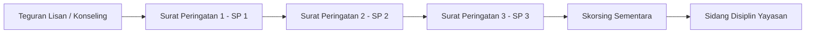
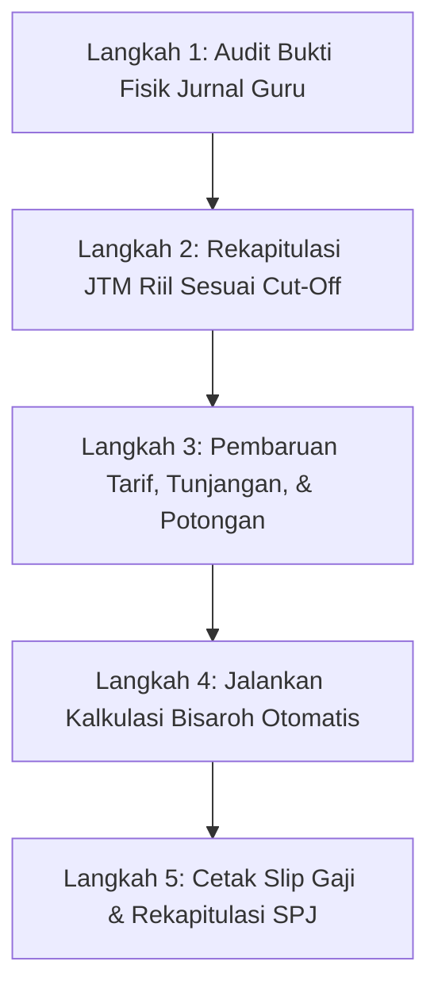

# 📘 Panduan Penggunaan Aplikasi Guru App (Multi-Role User Manual)

> **Versi Dokumen:** 2.5 (Oktober 2026)  
> **Target Pengguna:** Seluruh Pengguna Sekolah (Administrator, Guru Pengajar, Wali Kelas, Tim Kesiswaan, Kepala Sekolah, Bendahara Keuangan, dan Peserta Didik)  
> **Tema Desain:** Modern Neobrutalism UI & Mobile Progressive Web App (PWA)

---

## Daftar Isi

1. [Tentang Guru App](#1-tentang-guru-app)
   - [1.1 Visi & Integrasi Sistem](#11-visi--integrasi-sistem)
   - [1.2 Desain Neobrutalism & Dukungan PWA / Offline](#12-desain-neobrutalism--dukungan-pwa--offline)
   - [1.3 Aturan Baku Normalisasi Status Kehadiran (Alfa)](#13-aturan-baku-normalisasi-status-kehadiran-alfa)
2. [Matriks Hak Akses Pengguna (Role-Based Access Control)](#2-matriks-hak-akses-pengguna-role-based-access-control)
3. [Alur Autentikasi, Login, & Multi-Role Switching](#3-alur-autentikasi-login--multi-role-switching)
4. [Panduan Operasional: Administrator (Admin)](#4-panduan-operasional-administrator-admin)
   - [4.1 Dashboard Sentral & Monitoring Sistem](#41-dashboard-sentral--monitoring-sistem)
   - [4.2 Pengelolaan Pengguna & Hak Akses](#42-pengelolaan-pengguna--hak-akses)
   - [4.3 Master Data: Rombel, Mapel, & Siswa](#43-master-data-rombel-mapel--siswa)
   - [4.4 Penugasan KBM Dewan Guru](#44-penugasan-kbm-dewan-guru)
   - [4.5 Tahun Ajaran & Kalender Akademik](#45-tahun-ajaran--kalender-akademik)
   - [4.6 Promosi Kenaikan Kelas & Mutasi](#46-promosi-kenaikan-kelas--mutasi)
   - [4.7 Radius Lokasi Presensi (Geofencing GPS)](#47-radius-lokasi-presensi-geofencing-gps)
   - [4.8 Pengumuman Sekolah & Backup Database](#48-pengumuman-sekolah--backup-database)
5. [Panduan Operasional: Guru Pengajar](#5-panduan-operasional-guru-pengajar)
   - [5.1 Membaca Beranda & Jadwal Mengajar Harian](#51-membaca-beranda--jadwal-mengajar-harian)
   - [5.2 Presensi Sesi Jam Pelajaran (Mapel)](#52-presensi-sesi-jam-pelajaran-mapel)
   - [5.3 Pengisian Jurnal Mengajar (JTM - Kunci Bisaroh)](#53-pengisian-jurnal-mengajar-jtm---kunci-bisaroh)
   - [5.4 Pengelolaan Penilaian Siswa & Leger](#54-pengelolaan-penilaian-siswa--leger)
   - [5.5 Tugas Online & Ujian Mode CBT (Anti-Curang)](#55-tugas-online--ujian-mode-cbt-anti-curang)
   - [5.6 Pencatatan Poin Karakter & Prestasi](#56-pencatatan-poin-karakter--prestasi)
   - [5.7 Gamifikasi & Ice Breaking Kelas](#57-gamifikasi--ice-breaking-kelas)
   - [5.8 Bank Berkas, Agenda Catatan, & Unduh Rekap PDF](#58-bank-berkas-agenda-catatan--unduh-rekap-pdf)
6. [Panduan Operasional: Wali Kelas (Hub Terpadu `/wali-kelas`)](#6-panduan-operasional-wali-kelas-hub-terpadu-wali-kelas)
   - [6.1 Konsep Hybrid Role Wali Kelas](#61-konsep-hybrid-role-wali-kelas)
   - [6.2 Tab 1: Radar Masalah & Early Warning](#62-tab-1-radar-masalah--early-warning)
   - [6.3 Tab 2: Presensi Harian & 1-Klik Sahkan Rombel](#63-tab-2-presensi-harian--1-klik-sahkan-rombel)
   - [6.4 Tab 3: Leger Nilai Lintas Mata Pelajaran](#64-tab-3-leger-nilai-lintas-mata-pelajaran)
   - [6.5 Tab 4: Pengawasan Poin Karakter Kelas Binaan](#65-tab-4-pengawasan-poin-karakter-kelas-binaan)
   - [6.6 Tab 5: Direktori Siswa & Kontak Cepat Orang Tua](#66-tab-5-direktori-siswa--kontak-cepat-orang-tua)
7. [Panduan Operasional: Bidang Kesiswaan (`/kesiswaan/*`)](#7-panduan-operasional-bidang-kesiswaan-kesiswaan)
   - [7.1 Radar Absensi & Deteksi Bolos Jam Pelajaran](#71-radar-absensi--deteksi-bolos-jam-pelajaran)
   - [7.2 Hub Poin Karakter & Razia Pelanggaran Massal](#72-hub-poin-karakter--razia-pelanggaran-massal)
   - [7.3 Penanganan Kasus Berjenjang (Buku Bimbingan Santri)](#73-penanganan-kasus-berjenjang-buku-bimbingan-santri)
   - [7.4 Generator Resmi Surat Pemanggilan Orang Tua (Kop & QR)](#74-generator-resmi-surat-pemanggilan-orang-tua-kop--qr)
8. [Panduan Operasional: Kepala Sekolah (`/kepsek/*`)](#8-panduan-operasional-kepala-sekolah-kepsek)
   - [8.1 Filosofi Supervisi Eksekutif (Read-Only)](#81-filosofi-supervisi-eksekutif-read-only)
   - [8.2 Dashboard Eksekutif & KPI Institusi](#82-dashboard-eksekutif--kpi-institusi)
   - [8.3 Supervisi Jurnal Pembelajaran Guru](#83-supervisi-jurnal-pembelajaran-guru)
   - [8.4 Rekapitulasi Capaian Nilai & Standar KKM](#84-rekapitulasi-capaian-nilai--standar-kkm)
   - [8.5 Pemantauan Presensi Makro & Kedisiplinan](#85-pemantauan-presensi-makro--kedisiplinan)
   - [8.6 Supervisi Anggaran Bisaroh & Beban Mengajar](#86-supervisi-anggaran-bisaroh--beban-mengajar)
   - [8.7 Cetak Dokumen Laporan Komprehensif](#87-cetak-dokumen-laporan-komprehensif)
9. [Panduan Operasional: Bendahara / Keuangan (`/bendahara/*`)](#9-panduan-operasional-bendahara--keuangan-bendahara)
   - [9.1 SOP Siklus Penggajian Bulanan](#91-sop-siklus-penggajian-bulanan)
   - [9.2 Langkah 1: Audit Jurnal KBM Guru](#92-langkah-1-audit-jurnal-kbm-guru)
   - [9.3 Langkah 2: Rekapitulasi Jam Tatap Muka Riil (JTM)](#93-langkah-2-rekapitulasi-jam-tatap-muka-riil-jtm)
   - [9.4 Langkah 3: Konfigurasi Tarif JP, Tunjangan, & Potongan](#94-langkah-3-konfigurasi-tarif-jp-tunjangan--potongan)
   - [9.5 Langkah 4: Kalkulasi Bisaroh Otomatis](#95-langkah-4-kalkulasi-bisaroh-otomatis)
   - [9.6 Langkah 5: Penerbitan Slip Gaji Digital & SPJ Penggajian](#96-langkah-5-penerbitan-slip-gaji-digital--spj-penggajian)
10. [Panduan Operasional: Siswa / Ujian Online CBT](#10-panduan-operasional-siswa--ujian-online-cbt)
    - [10.1 Prosedur Masuk Ujian via PIN](#101-prosedur-masuk-ujian-via-pin)
    - [10.2 Ketentuan Anti-Curang (CBT Lockdown)](#102-ketentuan-anti-curang-cbt-lockdown)
    - [10.3 Penyimpanan Draf Otomatis & Pengumpulan Ujian](#103-penyimpanan-draf-otomatis--pengumpulan-ujian)
11. [Rencana Peran Tahap Lanjutan (Roadmap)](#11-rencana-peran-tahap-lanjutan-roadmap)
12. [Kebijakan Logika Bisnis & Perhitungan Otomatis](#12-kebijakan-logika-bisnis--perhitungan-otomatis)
13. [Pertanyaan Sering Diajukan (FAQ) & Solusi Masalah](#13-pertanyaan-sering-diajukan-faq--solusi-masalah)
14. [Direktori Cepat Akses Halaman (URL Directory)](#14-direktori-cepat-akses-halaman-url-directory)

---

## 1. Tentang Guru App

### 1.1 Visi & Integrasi Sistem

**Guru App** adalah platform terpadu ekosistem manajemen sekolah dan pesantren yang mengintegrasikan seluruh lini kegiatan:

1. **Akademik & KBM:** Perencanaan jadwal, pencatatan absensi sesi mata pelajaran, penilaian berkala, bank soal, dan ujian online.
2. **Administrasi Guru & Bisaroh Berbasis Bukti:** Setiap honor/bisaroh guru dihitung secara akurat dan transparan dari **Jam Tatap Muka (JTM)** riil yang tercatat pada jurnal mengajar harian.
3. **Ketertiban & Pembinaan Karakter:** Monitoring kedisiplinan makro sekolah, radar deteksi bolos jam pelajaran, sistem poin pelanggaran/prestasi bertingkat, serta otomatisasi persuratan pemanggilan orang tua.
4. **Supervisi Eksekutif:** Memungkinkan Kepala Sekolah memantau seluruh denyut nadi institusi secara _real-time_ tanpa mengganggu atau merusak (_zero-mutation_) data operasional guru.

```
                           ┌───────────────────────────┐
                           │      GURU APP SYSTEM      │
                           └─────────────┬─────────────┘
                                         │
        ┌───────────────────┬────────────┴────────────┬───────────────────┐
        ▼                   ▼                         ▼                   ▼
┌───────────────┐   ┌───────────────┐         ┌───────────────┐   ┌───────────────┐
│     ADMIN     │   │     GURU      │         │   KESISWAAN   │   │   BENDAHARA   │
│ Master Data,  │   │ KBM, Absensi, │         │ Radar Bolos,  │   │ JTM Riil,     │
│ Akun, Jadwal, │   │ Jurnal JTM,   │         │ Poin Santri,  │   │ Tarif JP,     │
│ Promosi Kelas │   │ Penilaian CBT │         │ Bimbingan/SP  │   │ Bisaroh & Slip│
└───────────────┘   └───────┬───────┘         └───────────────┘   └───────────────┘
                            │
                            ▼
                    ┌───────────────┐         ┌───────────────┐
                    │  WALI KELAS   │         │ KEPALA SEKOLAH│
                    │ Hub Rombel,   │         │ Supervisi KBM,│
                    │ Leger Nilai,  │         │ Audit Jurnal, │
                    │ Early Warning │         │ Pantau Poin   │
                    └───────────────┘         └───────────────┘
```

---

### 1.2 Desain Neobrutalism & Dukungan PWA / Offline

- **Neobrutalism Aesthetics:** Menggunakan garis batas tebal (`border-2` / `border-3 border-black`), bayangan kontras tegas (`shadow-[3px_3px_0px_0px_#0D0D0D]`), serta palet warna fungsional yang memudahkan navigasi di layar ponsel maupun laptop.
- **PWA (Progressive Web App):** Aplikasi dapat dipasang (_Add to Home Screen_) pada perangkat Android, iOS, maupun Windows.
- **Mode Luring (Offline First):** Fitur-fitur esensial (seperti draft jawaban CBT dan pencatatan presensi darurat) dilengkapi penyimpanan lokal (_localStorage_) agar tidak kehilangan data saat sinyal internet sekolah terputus.

---

### 1.3 Aturan Baku Normalisasi Status Kehadiran (Alfa)

> [!IMPORTANT]
> **Aturan Wajib Aplikasi:**  
> Seluruh variasi ejaan status ketidakhadiran siswa tanpa keterangan berikut:
>
> - `"Alpa"` (ejaan umum dengan huruf **P** pada database)
> - `"Alfa"` (ejaan baku Bahasa Indonesia dengan huruf **F**)
> - `"ALPHA"` (label huruf tombol UI antarmuka)
> - `"A"` atau `"a"` (singkatan huruf status absensi)
>
> **Wajib secara otomatis dikenali dan dihitung seragam sebagai status "Alfa"** di seluruh dashboard, radar kesiswaan, rekap wali kelas, hingga laporan cetak.

---

## 2. Matriks Hak Akses Pengguna (Role-Based Access Control)

| Modul / Fitur                   | Administrator |  Guru Pengajar  |    Wali Kelas    |      Kesiswaan      | Kepala Sekolah |    Bendahara    |      Siswa      |
| :------------------------------ | :-----------: | :-------------: | :--------------: | :-----------------: | :------------: | :-------------: | :-------------: |
| **Kelola Pengguna & Akun**      |    ✅ CRUD    |       ❌        |        ❌        |         ❌          |   👁️ Pantau    |       ❌        |       ❌        |
| **Kelola Kelas & Mapel**        |    ✅ CRUD    |       ❌        |        ❌        |         ❌          |   👁️ Pantau    |       ❌        |       ❌        |
| **Penugasan Guru (KBM)**        |    ✅ CRUD    |       ❌        |        ❌        |         ❌          |   👁️ Pantau    |       ❌        |       ❌        |
| **Input Presensi Mapel**        |   ✅ Penuh    | ✅ Kelas Ampuan | ✅ Kelas Ampuan  |         ❌          |   👁️ Pantau    |       ❌        |       ❌        |
| **Sahkan Presensi Harian**      |      ❌       |       ❌        | ✅ Rombel Binaan |         ❌          |   👁️ Pantau    |       ❌        |       ❌        |
| **Input Jurnal Mengajar**       |      ❌       |   ✅ Jam Riil   |   ✅ Jam Riil    |         ❌          |  👁️ Supervisi  |    👁️ Audit     |       ❌        |
| **Input Nilai Siswa**           |      ❌       | ✅ Mapel Ampuan | ✅ Mapel Ampuan  |         ❌          |   👁️ Pantau    |       ❌        |       ❌        |
| **Pantau Leger Lintas Mapel**   |      ❌       |       ❌        | ✅ Rombel Binaan |         ❌          |   👁️ Pantau    |       ❌        |       ❌        |
| **Bank Soal & Ujian CBT**       |      ❌       | ✅ Kelola & PIN | ✅ Kelola & PIN  |         ❌          |       ❌       |       ❌        |   ✅ Kerjakan   |
| **Radar Absensi & Bolos**       |   👁️ Pantau   |       ❌        | 👁️ Kelas Binaan  | ✅ Seluruh Sekolah  |   👁️ Pantau    |       ❌        |       ❌        |
| **Poin & Perilaku Siswa**       |   ✅ Penuh    |  ✅ Input Sesi  | ✅ Pantau Binaan |   ✅ Razia/Verif    |   👁️ Pantau    |       ❌        | 👁️ Diri Sendiri |
| **Penerbitan SP & Panggilan**   |      ❌       |       ❌        |   Rekomendasi    | ✅ Penerbitan Resmi | 👁️ Mengetahui  |       ❌        |       ❌        |
| **Audit Jam Tatap Muka (JTM)**  |      ❌       |       ❌        |        ❌        |         ❌          |  👁️ Supervisi  |  ✅ Verifikasi  |       ❌        |
| **Tarif, Tunjangan & Potongan** |      ❌       |       ❌        |        ❌        |         ❌          |   👁️ Pantau    | ✅ Kelola Penuh |       ❌        |
| **Kalkulasi & Slip Gaji**       |      ❌       |  👁️ Slip Diri   |   👁️ Slip Diri   |         ❌          |   👁️ Pantau    |  ✅ Terbitkan   |       ❌        |
| **Promosi Kelas / Mutasi**      |  ✅ Eksekusi  |       ❌        |   Rekomendasi    |         ❌          |   👁️ Pantau    |       ❌        |       ❌        |

---

## 3. Alur Autentikasi, Login, & Multi-Role Switching

### 3.1 Prosedur Masuk Sistem (Login)

1. Buka alamat aplikasi di browser atau buka aplikasi dari Home Screen perangkat Anda.
2. Jika belum login, Anda akan otomatis diarahkan ke halaman login resmi: `/login`.
3. Masukkan **Username** (atau NIP/Email) dan **Kata Sandi**.
4. Tekan tombol **"Masuk ke Sistem"**.
5. Server akan memvalidasi kredensial pengguna dan secara instan (_zero-flicker_) mengarahkan Anda ke portal utama sesuai peran akun Anda:
   - **Admin** $\rightarrow$ `/admin` (Pusat Administrator)
   - **Kepala Sekolah** $\rightarrow$ `/kepsek` (Portal Eksekutif)
   - **Bendahara** $\rightarrow$ `/bendahara` (Portal Keuangan)
   - **Kesiswaan** $\rightarrow$ `/kesiswaan` (Radar & Tata Tertib)
   - **Guru Pengajar** $\rightarrow$ `/` (Beranda KBM Guru)

### 3.2 Dual-Role & Multi-Role Switching

Di lingkungan sekolah, seorang Guru sering kali merangkap jabatan sebagai **Wali Kelas** atau anggota **Tim Kesiswaan**. Sistem mengakomodasi kebutuhan ini tanpa mengharuskan pengguna berganti akun (_Single Identity SSO_):

- **Guru yang menjadi Wali Kelas:** Pada beranda Guru (`/`), akan muncul Banner Interaktif Neobrutalism beraksen emas:  
  `🌟 WALI KELAS AKTIF • ROMBEL [NAMA KELAS]`.  
  Cukup klik tombol **"Buka Hub Wali Kelas ➜"** untuk berpindah ke workspace khusus `/wali-kelas`.
- **Guru yang menjadi Tim Kesiswaan / Admin / Kepsek:** Terdapat tombol pintasan navigasi di sidebar atau menu atas untuk berpindah antar portal secara mulus.

---

## 4. Panduan Operasional: Administrator (Admin)

Portal Administrator terletak di `/admin/*` dan dirancang khusus untuk staf IT atau penanggung jawab sistem madrasah/sekolah.

```
┌─────────────────────────────────────────────────────────────┐
│                   DASHBOARD ADMINISTRATOR                   │
├──────────────┬──────────────┬──────────────┬────────────────┤
│ 👥 Pengguna  │ 🏫 Rombel    │ 📚 Mapel     │ 👨‍🎓 Siswa       │
│ 42 Akun Aktif│ 12 Rombel    │ 24 Mapel     │ 380 Siswa      │
└──────────────┴──────────────┴──────────────┴────────────────┘
┌─────────────────────────────────────────────────────────────┐
│ Modul Utama:                                                │
│ [Penugasan KBM]  [Tahun Ajaran]  [Promosi Kelas] [Geofencing]│
│ [Pengumuman]     [Profil Sekolah] [Backup & Restore Data]   │
└─────────────────────────────────────────────────────────────┘
```

### 4.1 Dashboard Sentral & Monitoring Sistem

- Menampilkan ringkasan metrik total akun pengguna terdaftar, jumlah rombel, mapel, siswa aktif, status semester aktif, serta tanggal backup database terakhir.
- Tombol aksi cepat untuk menambah entitas data baru dalam hitungan detik.

### 4.2 Pengelolaan Pengguna & Hak Akses (`/admin/pengguna`)

1. **Membuat Akun Baru:**
   - Tekan tombol **"+ Tambah Pengguna"**.
   - Masukkan _Username_, _Nama Lengkap_, _Email (opsional)_, dan tentukan **Role** (`Admin`, `Guru`, `Kepala Sekolah`, `Bendahara`, atau `Kesiswaan`).
   - Masukkan kata sandi awal atau gunakan fitur _auto-generate_.
   - Tekan **"Simpan Akun"**.
2. **Reset Kata Sandi Pengguna:**
   - Cari nama guru/staf pada kolom pencarian.
   - Klik tombol **Kunci / Gembok (Reset Password)**.
   - Tentukan password baru, konfirmasi, lalu serahkan kepada pemilik akun.
3. **Mengaktifkan / Menonaktifkan Akun:**
   - Gunakan tombol saklar status untuk menonaktifkan akun guru yang telah mutasi atau cuti panjang tanpa menghapus riwayat KBM masa lalunya.

### 4.3 Master Data: Rombel, Mapel, & Siswa

- **Kelola Kelas (`/admin/kelas`):**
  - Buat tingkatan rombel (contoh: _7-A_, _7-B_, _X-IPA-1_).
  - Tentukan wali kelas pengampu untuk rombel tersebut.
- **Kelola Mata Pelajaran (`/admin/mapel`):**
  - Daftarkan mata pelajaran kurikulum (contoh: _Matematika_, _Bahasa Arab_, _Fikih_), kode mapel, serta rumpun mata pelajaran.
- **Kelola Siswa (`/admin/siswa`):**
  - Tambah siswa perorangan atau gunakan fitur **"Import Excel / CSV"** untuk mengunggah ratusan data siswa sekaligus beserta NIS, NISN, jenis kelamin, dan nomor telepon wali murid.

### 4.4 Penugasan KBM Dewan Guru (`/admin/penugasan`)

1. Pilih nama guru pengajar.
2. Hubungkan guru tersebut dengan kombinasi **Kelas** dan **Mata Pelajaran** yang diampunya.
3. _Dampaknya:_ Guru hanya akan melihat rombel dan mata pelajaran yang ditugaskan kepadanya saat membuka menu Absensi, Jurnal, dan Penilaian.

### 4.5 Tahun Ajaran & Kalender Akademik (`/admin/tahun-ajar`)

- Mengelola periode aktif (contoh: _2026/2027 Ganjil_).
- Menandai satu semester sebagai **Status Aktif**. Seluruh transaksi KBM, perhitungan jurnal, dan absensi harian akan dikaitkan otomatis dengan tahun ajaran aktif tersebut.

### 4.6 Promosi Kenaikan Kelas & Mutasi (`/admin/promosi-kelas`)

- Dilakukan setiap akhir tahun ajaran.
- Pilih kelas asal (contoh: _Kelas 7-A_) dan tentukan kelas tujuan (contoh: _Kelas 8-A_).
- Centang siswa yang dinyatakan naik kelas, lalu tekan **"Eksekusi Promosi Kelas"**. Sistem secara massal memindahkan siswa ke rombel baru.
- Siswa tingkat akhir dapat dialihkan ke status **"Alumni / Lulus"**.

### 4.7 Radius Lokasi Presensi (Geofencing GPS) (`/admin/lokasi-sekolah`)

- Menentukan titik koordinat sekolah (_Latitude & Longitude_) menggunakan peta interaktif.
- Menentukan radius batas toleransi (contoh: _100 meter_).
- Mencegah guru atau siswa mengisi presensi jika perangkat mereka berada di luar area lingkungan sekolah.

### 4.8 Pengumuman Sekolah & Backup Database

- **Pengumuman (`/admin/pengumuman`):** Menerbitkan siaran informasi resmi sekolah yang akan muncul di dashboard seluruh guru dan staf.
- **Backup Data (`/admin/backup`):** Mengunduh arsip database lengkap dalam format JSON/SQL sebagai langkah mitigasi pemulihan bencana (_Disaster Recovery_).

---

## 5. Panduan Operasional: Guru Pengajar

Guru pengajar adalah pengguna inti operasional harian sekolah. Halaman utama guru berada di `/`.

```
┌─────────────────────────────────────────────────────────────┐
│                    BERANDA GURU PENGAJAR                    │
├─────────────────────────────────────────────────────────────┤
│ 🌟 [WALI KELAS AKTIF - KELAS 8-B] (Tombol Hub Khusus)       │
├─────────────────────────────────────────────────────────────┤
│ 📅 Jadwal Mengajar Hari Ini:                                │
│ • 07.30 - 09.00 : Matematika (Kelas 8-B) [Presensi] [Jurnal]│
│ • 09.15 - 10.45 : Matematika (Kelas 9-A) [Presensi] [Jurnal]│
├─────────────────────────────────────────────────────────────┤
│ Menu Cepat:                                                 │
│ [📋 Absensi]  [📊 Penilaian]  [📝 Jurnal KBM]  [⭐ Poin]     │
│ [📚 Bank Soal] [🎮 Ice Breaking] [📁 Bank Berkas] [🖨️ Laporan]│
└─────────────────────────────────────────────────────────────┘
```

### 5.1 Membaca Beranda & Jadwal Mengajar Harian

- Saat membuka aplikasi di pagi hari, kartu jadwal otomatis menampilkan sesi mengajar Anda hari ini berurutan berdasarkan jam mulai.
- Terdapat indikator cepat apakah sesi tersebut sudah diisi absensi dan jurnalnya atau masih tertunda (_pending_).

### 5.2 Presensi Sesi Jam Pelajaran (Mapel) (`/absensi`)

1. Pilih **Kelas**, **Mata Pelajaran**, dan **Tanggal Pertemuan**.
2. Daftar seluruh siswa kelas tersebut akan tampil beserta tombol status:
   - **H (Hadir):** Nilai bawaan (_default_ seluruh siswa langsung terpilih hadir untuk menghemat waktu).
   - **S (Sakit):** Wajib melampirkan keterangan jika ada surat dokter.
   - **I (Izin):** Untuk siswa dengan keperluan keluarga sah.
   - **A (Alfa / Alpa):** Untuk siswa yang tidak hadir tanpa kabar sama sekali.
3. Tekan **"Simpan Presensi Mapel"**.
4. Data kehadiran ini akan langsung tersambung ke radar pengawasan Kesiswaan untuk mendeteksi potensi bolos jam pelajaran.

### 5.3 Pengisian Jurnal Mengajar (JTM - Kunci Bisaroh) (`/jurnal`)

> [!IMPORTANT]
> **PENTING BAGI KESEJAHTERAAN GURU:**  
> Penghitungan honor/bisaroh guru pada sistem ini didasarkan pada akumulasi **Jam Tatap Muka (JTM)** riil dari Jurnal Mengajar yang Anda isi. Jika Anda mengajar tetapi lupa mengisi jurnal, jam tersebut tidak dapat dihitung oleh Bendahara!

1. Klik tombol **"+ Isi Jurnal Mengajar"** (atau langsung dari shortcut di jadwal hari ini).
2. Lengkapi formulir jurnal:
   - **Kelas & Mapel:** Pilih rombel yang baru saja selesai diajar.
   - **Jam Ke (JTM):** Pilih rentang jam pelajaran, misalnya `1 - 2` (berarti bernilai 2 JP) atau `3 - 5` (bernilai 3 JP).
   - **Materi Pembelajaran:** Ringkasan materi pokok yang diajarkan hari ini.
   - **Tujuan Pembelajaran / Capaian (TP):** Kompetensi yang dicapai siswa.
   - **Catatan & Kendala Kelas:** Tuliskan jika ada kendala proyektor rusak, siswa yang tertidur, atau situasi darurat di kelas.
   - **Dokumentasi Bukti Fisik:** Unggah foto suasana KBM atau foto papan tulis sebagai bukti sah mengajar.
3. Klik **"Simpan Jurnal"**.

### 5.4 Pengelolaan Penilaian Siswa & Leger (`/penilaian`)

1. Pilih **Kelas** dan **Mata Pelajaran**.
2. **Membuat Kolom Nilai Baru:**
   - Tekan **"+ Tambah Penilaian"**.
   - Tentukan jenis asesmen: _Tugas Harian_, _Kuis_, _Ulangan Formatif_, _Asesmen Sumatif Tengah Semester (STS)_, atau _Asesmen Akhir Semester (SAS)_.
   - Tentukan bobot dan Kriteria Ketercapaian Tujuan Pembelajaran (KKTP / KKM).
3. **Input Nilai:**
   - Masukkan angka nilai (0 - 100) per siswa secara langsung pada tabel.
   - Tersedia tombol import nilai dari spreadsheet Excel jika Anda mengoreksi secara offline.
4. Nilai akhir rata-rata dan status kelulusan KKM akan terhitung secara otomatis.

### 5.5 Tugas Online & Ujian Mode CBT (Anti-Curang) (`/tugas` & `/soal`)

1. **Membuat Paket Ujian / Tugas:**
   - Masuk ke menu `/soal` lalu klik **"+ Buat Paket Soal"**.
   - Masukkan judul kuis, petunjuk pengerjaan, dan durasi pengerjaan (menit).
   - Tambahkan butir soal: _Pilihan Ganda (PG)_ lengkap dengan opsi A-E dan kunci jawaban, serta _Soal Esai_.
2. **Aktivasi Fitur CBT Mode (Computer Based Test):**
   - Centang opsi **"Aktifkan Mode CBT Ketat (Lockdown & Anti-Curang)"**.
   - Tentukan **Kode Buka Kunci (Unlock Code)** untuk pengawas ruangan.
3. **Mendistribusikan ke Siswa:**
   - Sistem akan menerbitkan **Kode PIN Soal** (contoh: `MAT-8B-01`).
   - Berikan kode PIN ini kepada siswa saat jam ujian dimulai.
4. **Melihat Hasil Ujian:**
   - Pada halaman `/tugas/hasil/[pin]`, guru dapat melihat jawaban siswa, nilai PG otomatis keluar, memberi nilai esai manual, dan mengekspor hasil ke format Excel.

### 5.6 Pencatatan Poin Karakter & Prestasi (`/poin`)

- Saat melihat siswa yang berprestasi (misalnya: _Mampu menghafal 1 Juz Al-Qur'an_, _Juara Lomba Kaligrafi_), klik tombol **"+ Beri Poin Positif"**.
- Saat mendapati siswa melanggar tata tertib di kelas (misalnya: _Makan saat jam pelajaran_, _Membawa gawai tanpa izin_), klik **"+ Catat Pelanggaran"**.
- Poin ini langsung terintegrasi dengan rapor sikap dan buku sanksi kesiswaan.

### 5.7 Gamifikasi & Ice Breaking Kelas (`/game`)

Untuk menjaga antusiasme belajar siswa, Guru App menyediakan _tools_ interaktif dalam kelas:

- **Arisan Siswa Acak (`/game/arisan`):** Mengacak nama siswa di layar proyektor untuk maju menjawab pertanyaan secara adil dan menyenangkan.
- **Tebak Gambar:** Menampilkan kuis visual interaktif.
- **Hand Hockey:** Game mini relaksasi setelah sesi ulangan yang menegangkan.
- **Typing Challenge (`/typing`):** Melatih kecepatan mengetik santri di laboratorium komputer.
- **Generator Kelompok Acak (`/grup`):** Membagi kelas menjadi beberapa kelompok diskusi seimbang hanya dalam 1 klik.

### 5.8 Bank Berkas, Agenda Catatan, & Unduh Rekap PDF

- **Bank Berkas (`/berkas`):** Simpan modul ajar, silabus, RPP, dan materi PDF agar siap diunduh kapan saja tanpa perlu membawa flashdisk.
- **Catatan Guru (`/catatan`):** Buku agenda digital pribadi guru untuk mencatat rencana mengajar minggu depan atau evaluasi diri.
- **Cetak Laporan KBM (`/laporan`):** Menghasilkan dokumen rekap absensi dan nilai siswa berformat PDF rapi dengan kop surat resmi sekolah siap cetak untuk diserahkan ke kurikulum.

---

## 6. Panduan Operasional: Wali Kelas (Hub Terpadu `/wali-kelas`)

Role Wali Kelas adalah **Hybrid Role** yang memberikan wewenang supervisi menyeluruh atas satu rombongan belajar binaan tertentu.

```
┌─────────────────────────────────────────────────────────────┐
│                 HUB WALI KELAS: KELAS 8-B                   │
├─────────────────────────────────────────────────────────────┤
│ [📊 Radar Masalah] [📅 Presensi Rombel] [📑 Leger Nilai]    │
│ [🛡️ Poin Sikap]    [👥 Data & Kontak Ortu]                  │
├─────────────────────────────────────────────────────────────┤
│ 🚨 Early Warning Hari Ini:                                  │
│ • 1 Siswa Alfa $\ge$ 3 Hari Berturut-turut (Ahmad Fauzi)    │
│ • 2 Siswa Terdeteksi Bolos Sesi 3 (Hadir pagi, alfa siang)  │
│                                                             │
│ [⚡ 1-Klik Sahkan Presensi Harian dari Agregasi Mapel]      │
└─────────────────────────────────────────────────────────────┘
```

### 6.1 Konsep Hybrid Role Wali Kelas

- Wali kelas tidak perlu berganti akun. Akun guru Anda akan otomatis mengenali rombel binaan aktif yang ditetapkan oleh Administrator.
- Cukup klik banner emas di beranda guru untuk masuk ke portal sentral: `/wali-kelas`.

### 6.2 Tab 1: Radar Masalah & Early Warning

Menyajikan deteksi dini sebelum masalah siswa berlarut-larut:

1. **Peringatan Alfa Beruntun:** Menyorot siswa yang tidak masuk tanpa keterangan selama $\ge 3$ hari berturut-turut agar wali kelas segera melakukan panggilan telepon atau kunjungan rumah (_home visit_).
2. **Peringatan Poin Negatif Kritis:** Menampilkan siswa yang akumulasi pelanggarannya mendekati batas penerbitan Surat Peringatan (SP).
3. **Deteksi Siswa Bolos Sesi:** Menampilkan siswa yang tercatat hadir pada pelajaran pagi namun terdata alfa pada pelajaran siang.

### 6.3 Tab 2: Presensi Harian & 1-Klik Sahkan Rombel

Wali kelas bertanggung jawab mengesahkan buku absensi induk harian kelas:

1. **Fitur Cerdas: 1-Klik Sahkan Presensi Harian (`Sync Presensi`):**
   - Wali kelas tidak perlu mengabsen ulang satu per satu.
   - Sistem secara otomatis menghimpun seluruh presensi mapel yang diisi guru pengajar hari ini.
   - Menerapkan **Aturan Kehadiran $\ge 50\%$**: Jika siswa hadir di mayoritas sesi pelajaran, status hariannya otomatis disahkan sebagai **Hadir**. Jika siswa banyak tidak masuk sesi mapel, statusnya otomatis disesuaikan.
   - Tekan tombol **"⚡ Sahkan Presensi Harian Sekarang"**.
2. **Koreksi Manual:**
   - Jika ada siswa yang terlambat membawa surat izin susulan, wali kelas dapat mengubah statusnya secara manual lalu menyimpannya.

### 6.4 Tab 3: Leger Nilai Lintas Mata Pelajaran

- Menampilkan matriks tabel nilai seluruh siswa di kelas Anda untuk **semua mata pelajaran** (Matematika, IPA, Bahasa Indonesia, dll).
- Memudahkan wali kelas melihat:
  - Guru mapel mana yang belum menuntaskan input nilai menjelang pembagian buku rapor.
  - Siswa yang nilai akademiknya anjlok di banyak mata pelajaran sekaligus.
- Tombol **"Cetak Leger Nilai"** untuk mengunduh rekapitulasi semester.

### 6.5 Tab 4: Pengawasan Poin Karakter Kelas Binaan

- Memantau rekap poin kedisiplinan dan capaian prestasi khusus siswa di kelas binaan Anda.
- Mengonversi akumulasi poin ke nilai predikat sikap rapor (**A / Sangat Baik**, **B / Baik**, **C / Cukup**, **D / Perlu Bimbingan**).

### 6.6 Tab 5: Direktori Siswa & Kontak Cepat Orang Tua

- Daftar lengkap nomor induk (NIS/NISN), data ayah/ibu, dan alamat rumah.
- Tombol **WhatsApp Direct Link**: Klik ikon WhatsApp di samping nama orang tua untuk langsung membuka percakapan darurat di smartphone Anda tanpa perlu menyimpan nomor manual terlebih dahulu.

---

## 7. Panduan Operasional: Bidang Kesiswaan (`/kesiswaan/*`)

Bidang Kesiswaan (Wakasek Kesiswaan, Pembina OSIS, dan Tim Ketertiban Sekolah) mengendalikan ketertiban umum sekolah di portal `/kesiswaan/*`.

```
┌─────────────────────────────────────────────────────────────┐
│                 PORTAL KESISWAAN & KETERTIBAN               │
├─────────────────────────────────────────────────────────────┤
│ [📡 Radar Absensi & Bolos]   [⚖️ Poin & Perilaku Santri]    │
│ [📖 Buku Bimbingan Santri]   [✉️ Pemanggilan Orang Tua]     │
├─────────────────────────────────────────────────────────────┤
│ 🚨 Radar Kasus Terkini:                                     │
│ • Total Pelanggaran Pekan Ini : 14 Kasus                    │
│ • Siswa Status Siaga SP-1     : 3 Siswa                     │
│ • Rekor Prestasi Terbaru      : Juara 1 Robotik Nasional    │
└─────────────────────────────────────────────────────────────┘
```

### 7.1 Radar Absensi & Deteksi Bolos Jam Pelajaran (`/kesiswaan`)

- Menampilkan grafik makro tingkat kehadiran seluruh jenjang sekolah hari ini (% hadir, sakit, izin, dan alfa).
- **Early Warning Bolos KBM:** Menemukan inkonsistensi kehadiran siswa. Contoh: Siswa tercatat hadir di absensi gerbang atau jam ke-1, namun tiba-tiba berstatus alfa pada jam ke-4 (indikasi membolos kantin atau melompati pagar sekolah).

### 7.2 Hub Poin Karakter & Razia Pelanggaran Massal (`/kesiswaan/poin`)

1. **Pencatatan Razia Massal:**
   - Saat tim tatib melakukan razia kedisiplinan (misal: _Pemeriksaan rambut, atribut seragam, atau razia rokok_), gunakan fitur **"Input Pelanggaran Massal"**.
   - Pilih jenis pelanggaran dari katalog tata tertib.
   - Centang belasan siswa yang terjaring sekaligus, lalu klik **"Simpan Poin Masal"**.
2. **Pencatatan Rekor Prestasi Siswa:**
   - Klik **"+ Tambah Prestasi Siswa"**.
   - Masukkan nama ajang (contoh: _Olimpiade Sains Nasional Bidang Fisika_), tingkat perlombaan (Kecamatan, Kabupaten, Provinsi, Nasional, Internasional), serta perolehan medali/juara.
   - Berikan poin reward positif yang akan mendongkrak skor kepribadian siswa.

### 7.3 Penanganan Kasus Berjenjang (Buku Bimbingan Santri) (`/kesiswaan/penanganan`)

Kesiswaan mengelola eskalasi kasus disiplin secara bertahap dan tercatat rapi secara digital:



1. **Membuka Kasus Baru:**
   - Cari profil siswa yang melakukan pelanggaran berat.
   - Masukkan kronologi kejadian, saksi, dan bukti pelanggaran.
2. **Menentukan Tahapan Sanksi:**
   - Pilih tingkatan penanganan: _Teguran Lisan_, _Surat Peringatan 1 (SP-1)_, _Surat Peringatan 2 (SP-2)_, _Surat Peringatan 3 (SP-3)_, _Skorsing_, atau _Sidang Pleno Disiplin_.
3. **Pencatatan Komitmen Siswa:**
   - Masukkan butir komitmen perbaikan diri yang disepakati siswa dan wali kelas.
   - Status penanganan dapat dipantau: _Dalam Proses_, _Selesai / Terbina_, atau _Eskalasi Lanjut_.

### 7.4 Generator Resmi Surat Pemanggilan Orang Tua (Kop & QR) (`/kesiswaan/pemanggilan-ortu`)

Ketika siswa memerlukan kehadiran wali murid ke sekolah:

1. Tekan tombol **"+ Terbitkan Surat Panggilan"**.
2. Pilih nama siswa (identitas kelas dan wali kelas akan terisi otomatis oleh sistem).
3. Isi detail surat:
   - **Nomor Surat:** Digenerate otomatis sesuai format penomoran tata usaha sekolah (contoh: `421.3/084/SMK-TI/X/2026`).
   - **Hari, Tanggal, & Jam Pertemuan.**
   - **Tempat:** Ruang Kesiswaan / Ruang BK.
   - **Menghadap Kepada:** Nama staf kesiswaan atau guru BK yang bertugas.
   - **Keperluan:** Uraian alasan pemanggilan secara santun dan formal.
4. **Cetak PDF Langsung:**
   - Sistem akan menyusun surat resmi berformat PDF lengkap dengan **Kop Surat Sekolah**, garis ganda, cap/tanda tangan, serta **QR Code Keabsahan Dokumen**.
   - Surat siap dicetak di kertas A4 atau dikirimkan via PDF kepada wali murid.

---

## 8. Panduan Operasional: Kepala Sekolah (`/kepsek/*`)

Portal Kepala Sekolah terletak di `/kepsek/*` dan didesain khusus sebagai instrumen supervisi manajerial tingkat tinggi (_Executive Leadership_).

```
┌─────────────────────────────────────────────────────────────┐
│                 PORTAL SUPERVISI KEPALA SEKOLAH             │
├─────────────────────────────────────────────────────────────┤
│ 👑 Mode Supervisi Eksekutif (Aman & Read-Only)              │
├─────────────────────────────────────────────────────────────┤
│ Indikator Hari Ini:                                         │
│ • KBM Berjalan     : 96% Guru Hadir Tepat Waktu             │
│ • Jurnal Terisi    : 38 dari 42 Sesi Mengajar               │
│ • Rata-rata Sekolah: 82.4 (Capaian Akademik Baik)           │
├─────────────────────────────────────────────────────────────┤
│ Menu Supervisi:                                             │
│ [Supervisi Jurnal] [Rekap Nilai Siswa] [Presensi Mapel]     │
│ [Karakter Siswa]   [Persetujuan Bisaroh] [Laporan Sekolah]  │
└─────────────────────────────────────────────────────────────┘
```

### 8.1 Filosofi Supervisi Eksekutif (Read-Only)

- **Zero-Mutation Safety:** Seluruh menu di portal Kepala Sekolah bersifat pemantauan (_read-only_). Kepala Sekolah dapat memeriksa seluruh data tanpa khawatir mengubah, menghapus, atau merusak data operasional yang sedang diinput oleh guru.
- Dilengkapi fitur ekspor laporan ke format Excel dan cetak dokumen resmi berformat standar pendidikan.

### 8.2 Dashboard Eksekutif & KPI Institusi (`/kepsek`)

- **Key Performance Indicators (KPI):**
  - Rasio kehadiran guru hari ini.
  - Jumlah jurnal mengajar yang telah diserahkan guru hari ini.
  - Statistik kehadiran siswa sekolah (% hadir vs alpa).
  - Grafik tren perkembangan nilai siswa per jenjang rombel.

### 8.3 Supervisi Jurnal Pembelajaran Guru (`/kepsek/jurnal`)

1. Kepala sekolah dapat memfilter jurnal mengajar berdasarkan **Nama Guru**, **Rombel**, atau **Rentang Tanggal**.
2. Periksa kesesuaian:
   - Apakah materi yang diajarkan sesuai dengan kurikulum/silabus.
   - Jam masuk riil dan jumlah jam mengajar (JTM) guru.
   - Bukti foto pembelajaran di kelas.
   - Catatan kendala lapangan guru (contoh: _butuh perbaikan spidol/AC_).
3. Tombol **"Cetak Rekap Supervisi Jurnal"** untuk bukti fisik supervisi pengawas dinas / yayasan.

### 8.4 Rekapitulasi Capaian Nilai & Standar KKM (`/kepsek/penilaian`)

- Memantau sebaran nilai seluruh mata pelajaran.
- Melihat rata-rata kelas dan membandingkan performa akademik antar rombel.
- Mengidentifikasi persentase siswa yang memerlukan program pengayaan (_enrichment_) maupun bimbingan remedial.

### 8.5 Pemantauan Presensi Makro & Kedisiplinan (`/kepsek/absensi` & `/kepsek/poin`)

- Memeriksa rekapitulasi kehadiran siswa sekolah secara berkala per bulan.
- Memantau siswa-siswa yang mengukir prestasi gemilang bagi nama baik sekolah serta siswa yang sedang dalam pembinaan sanksi berat kesiswaan.

### 8.6 Supervisi Anggaran Bisaroh & Beban Mengajar (`/kepsek/bisaroh`)

- Memantau estimasi beban jam tatap muka dewan guru dan proyeksi pengeluaran anggaran honorarium bulanan sebelum disahkan dan dicairkan oleh Bendahara Yayasan.

### 8.7 Cetak Dokumen Laporan Komprehensif (`/kepsek/laporan`)

- Menghasilkan buku laporan akreditasi sekolah komprehensif yang merangkum kehadiran, jurnal KBM, dan prestasi dalam satu bundel PDF siap cetak.

---

## 9. Panduan Operasional: Bendahara / Keuangan (`/bendahara/*`)

Portal Bendahara Keuangan terletak di `/bendahara/*` dan memegang kendali atas penghitungan honorarium guru (Bisaroh), tunjangan struktural, tunjangan dinamis, potongan, dan penerbitan slip gaji digital.

```
┌─────────────────────────────────────────────────────────────┐
│                 PORTAL KEUANGAN & BISAROH GURU              │
├─────────────────────────────────────────────────────────────┤
│ 💼 Cut-off Bulan Ini: Tgl 26 Bulan Lalu s/d Tgl 25 Bulan Ini│
├──────────────┬──────────────┬──────────────┬────────────────┤
│ Total JTM    │ Estimasi     │ Status Audit │ Dewan Guru     │
│ 1,420 JP     │ Rp 54.850.000│ 100% Selesai │ 32 Guru        │
└──────────────┴──────────────┴──────────────┴────────────────┘
┌─────────────────────────────────────────────────────────────┐
│ Alur Penggajian:                                            │
│ [1. Audit Jurnal] ➔ [2. Rekap JTM] ➔ [3. Tarif & Tunjangan] │
│ ➔ [4. Kalkulasi Bisaroh] ➔ [5. Cetak Slip Gaji & SPJ]       │
└─────────────────────────────────────────────────────────────┘
```

### 9.1 SOP Siklus Penggajian Bulanan

Penghitungan bisaroh guru mengikuti siklus bulanan standar 5 langkah:



---

### 9.2 Langkah 1: Audit Jurnal KBM Guru (`/bendahara/jurnal`)

Sebelum honor dicairkan, bendahara wajib memastikan bahwa jam tatap muka yang diajukan oleh guru memang benar-benar terlaksana:

1. Buka menu **"Audit Jurnal KBM"**.
2. Periksa jurnal guru pada bulan berjalan.
3. Pastikan foto bukti kegiatan belajar diunggah dan keterangan materi terisi jelas.
4. Jurnal yang sah akan menjadi dasar pembentukan jam tatap muka (JTM).

---

### 9.3 Langkah 2: Rekapitulasi Jam Tatap Muka Riil (JTM) (`/bendahara/jtm`)

1. Masuk ke menu **"Rekap JTM & Hadir"**.
2. Sistem secara cerdas mengagregasi seluruh sesi mengajar dari tabel jurnal guru berdasarkan **Rentang Tanggal Cut-Off** (misalnya: _tanggal 26 bulan lalu hingga tanggal 25 bulan ini_).
3. Menghitung dua metrik penting:
   - **Total JTM (Jam Tatap Muka / JP):** Jumlah akumulasi jam mengajar guru.
   - **Total Hari Hadir Riil:** Berapa hari fisik guru hadir di sekolah untuk mengajar.

---

### 9.4 Langkah 3: Konfigurasi Tarif JP, Tunjangan, & Potongan (`/bendahara/tarif`)

Halaman ini memiliki 4 tab fleksibel yang dapat dikonfigurasi tanpa harus mengubah kode aplikasi (_Full CRUD_):

1. **Tab 1: Tingkatan Guru & Penetapan Tarif JP:**
   - Mendukung multi-tier tingkatan guru. Contoh bawaan:
     - _Guru Senior:_ Rp 45.000 / JP
     - _Guru Madya:_ Rp 40.000 / JP
     - _Guru Junior / Pemula:_ Rp 35.000 / JP
   - Bendahara dapat menambah tingkatan baru (misal: _GTY_, _GTT_, _Guru Kehormatan_) serta menetapkan tingkatan masing-masing guru pada tabel _Assignment_.
2. **Tab 2: Tunjangan Pokok Bawaan Sistem:**
   - **Tunjangan Wali Kelas:** Otomatis diberikan secara selektif hanya kepada guru yang memiliki rombel binaan aktif (contoh: _Rp 150.000 / bulan_).
   - **Tunjangan Kehadiran / Uang Makan Harian:** Dikalikan dengan jumlah hari hadir riil guru berdasarkan jurnal (contoh: _Rp 15.000 / hari masuk_).
3. **Tab 3: Tunjangan Tambahan Fleksibel:**
   - Tambahkan tunjangan institusi baru sesuai kebutuhan yayasan:
     - Pilihan tipe hitung: **Per Bulan** (tetap), **Per Hari Hadir**, atau **Per JP**.
     - Pilihan sasaran penerima: **Semua Guru** atau **Guru Pilihan Tertentu**.
     - Contoh: _Uang Transport Bulanan (Rp 200.000)_, _Tunjangan Pembina OSIS (Rp 100.000)_.
4. **Tab 4: Potongan Dinamis:**
   - Pengelolaan iuran atau kewajiban guru:
     - Contoh: _Infaq Sosial Yayasan_, _Iuran Koperasi Guru_, _Potongan Kas Paguyuban_.
5. **Pengaturan Tanggal Cut-Off:**
   - Menentukan batas penutupan pembukuan bulanan (default: tanggal 25 setiap bulan).

---

### 9.5 Langkah 4: Kalkulasi Bisaroh Otomatis (`/bendahara/bisaroh`)

1. Buka menu **"Kalkulasi Bisaroh"**.
2. Pilih periode bulan penggajian.
3. Klik tombol **"⚡ Hitung Ulang Bisaroh"**.
4. Formula perhitungan matematis dijalankan secara instan untuk seluruh dewan guru:
   $$\text{Total Bisaroh} = (\text{Total JTM} \times \text{Tarif JP}) + \sum \text{Tunjangan Pokok} + \sum \text{Tunjangan Tambahan} - \sum \text{Potongan}$$
5. Tabel rincian transparan akan tersaji lengkap dengan breakdown komponen masing-masing guru.

---

### 9.6 Langkah 5: Penerbitan Slip Gaji Digital & SPJ Penggajian

1. **Cetak Slip Gaji Per Guru:**
   - Pada baris guru yang diinginkan, klik tombol **"Lihat Slip"**.
   - Modal slip gaji digital Neobrutalism akan terbuka menampilkan rincian honor JP, tunjangan, dan potongan secara transparan.
   - Klik **"🖨️ Cetak Slip Gaji"** untuk mencetak ke printer termal / kertas A4 atau menyimpannya sebagai file PDF.
2. **Cetak Surat Pertanggungjawaban (SPJ) / Rekap Penggajian:**
   - Klik tombol **"Unduh Rekapitulasi SPJ (Excel / PDF)"** di pojok kanan atas untuk laporan pembukuan yayasan lengkap dengan kolom tanda tangan dewan guru.

---

## 10. Panduan Operasional: Siswa / Ujian Online CBT

Peserta didik dapat mengikuti ujian daring mandiri melalui portal ramah gawai: `/soal`.

```
┌─────────────────────────────────────────────────────────────┐
│                 PORTAL UJIAN ONLINE SISWA                   │
├─────────────────────────────────────────────────────────────┤
│ 🔐 Masukkan PIN Soal : [ MAT-8B-01 ]                        │
│ 👤 Nama Siswa        : Ahmad Fauzi                          │
│ 🏫 Kelas / Absen     : Kelas 8-B / Nomor Absen 04           │
│                                                             │
│ [ 🚀 Mulai Kerjakan Ujian ]                                 │
└─────────────────────────────────────────────────────────────┘
```

### 10.1 Prosedur Masuk Ujian via PIN

1. Buka alamat `/soal` di browser ponsel atau laptop Anda.
2. Masukkan **Kode PIN Ujian** yang diberikan oleh bapak/ibu guru pengawas.
3. Pilih nama Anda dari daftar siswa kelas dan masukkan nomor absen.
4. Klik **"Mulai Kerjakan Ujian"**.

### 10.2 Ketentuan Anti-Curang (CBT Lockdown)

Jika ujian mengaktifkan fitur **CBT Mode**, perhatikan aturan ketat berikut:

- **Layar Penuh Otomatis:** Ujian wajib berlangsung dalam mode layar penuh (_fullscreen_).
- **Larangan Pindah Tab / Membuka Aplikasi Lain:** Dilarang beralih jendela browser, membuka kalkulator, membuka WhatsApp, atau menerima panggilan telepon.
- **Deteksi Pelanggaran (Violation Alert):**
  - Setiap kali Anda meninggalkan layar ujian, sistem membunyikan alarm peringatan dan mencatat 1 poin pelanggaran.
  - Jika pelanggaran mencapai batas toleransi ($\ge 2$ kali), **layar ujian akan otomatis terkunci total (`LOCKED`)**.
  - Siswa yang layarnya terkunci **wajib menghadap pengawas ruangan** untuk memasukkan _Kode Buka Kunci (Unlock Code)_ agar dapat melanjutkan ujian.

### 10.3 Penyimpanan Draf Otomatis & Pengumpulan Ujian

- **Auto-Save Jawaban:** Setiap jawaban yang Anda pilih atau teks esai yang Anda ketik disimpan seketika di penyimpanan lokal perangkat (_local storage_). Jika gawai kehabisan baterai atau koneksi Wi-Fi putus, jawaban Anda tidak akan hilang saat halaman dibuka kembali.
- **Pengumpulan Ujian:** Setelah menyelesaikan seluruh nomor soal, klik tombol hijau **"Kirim Lembar Jawaban"** dan konfirmasi pengumpulan.

---

## 11. Rencana Peran Tahap Lanjutan (Roadmap)

Sesuai dokumen arsitektur peran jangka panjang (`docs/ROLES.md`), peran-peran berikut sedang dalam tahap persiapan implementasi bertahap:

1. **Wali Murid (`/wali-murid`):** Portal khusus orang tua untuk memantau kehadiran anak di gerbang dan kelas, nilai harian anak, rekam jejak poin perilaku, serta tagihan administrasi sekolah secara langsung dari smartphone orang tua.
2. **Guru Bimbingan Konseling / BK (`/bk`):** Pengelolaan catatan konseling rahasia (_counseling log_), sosiometri kelas, dan rujukan kasus psikologis siswa.
3. **Petugas Keamanan / Pos Gerbang (`/keamanan`):** Antarmuka tablet pos satpam untuk mencatat jam kehadiran siswa di gerbang sekolah (scan kartu QR siswa) guna mendeteksi keterlambatan sejak pintu masuk sekolah.
4. **Tata Usaha / Administrasi (`/tu`):** Penerbitan surat keterangan aktif belajar, legalisir ijazah, dan pengelolaan berkas kearsipan siswa.

---

## 12. Kebijakan Logika Bisnis & Perhitungan Otomatis

Untuk memastikan transparansi dan kesamaan pemahaman bagi seluruh dewan guru dan staf, berikut ringkasan formula dan aturan komputasi yang diterapkan oleh Guru App:

### A. Kebijakan Normalisasi Status Ketidakhadiran (Alfa)

Sistem menggunakan fungsi normalisasi seragam `normStatus(val)`:

```javascript
export const normStatus = (val) => {
	const s = String(val || '')
		.trim()
		.toLowerCase();
	if (s === 'hadir' || s === 'h') return 'hadir';
	if (s === 'sakit' || s === 's') return 'sakit';
	if (s === 'izin' || s === 'i') return 'izin';
	if (s === 'alfa' || s === 'alpa' || s === 'alpha' || s === 'a') return 'alfa';
	return s;
};
```

_Dampaknya:_ Guru yang mengklik tombol status `"ALPHA"`, database yang menyimpan tulisan `"Alpa"`, atau laporan yang menuliskan `"A"` akan dibaca identik tanpa risiko data hilang atau salah hitung.

### B. Aturan Pengesahan Presensi Harian Wali Kelas (Threshold $\ge 50\%$)

Saat Wali Kelas menekan tombol 1-Klik Sahkan Presensi Harian dari sesi mapel:

- Dihitung: $\text{Rasio Kehadiran} = \frac{\text{Jumlah Sesi Hadir}}{\text{Total Sesi Mapel Hari Ini}}$
- Jika $\text{Rasio Kehadiran} \ge 0.5$ (50%), maka status harian siswa disahkan sebagai **Hadir**.
- Jika siswa memiliki catatan Sakit/Izin/Alfa yang dominan di sebagian besar jam pelajaran, status harian akan mengikuti status ketidakhadiran dominan tersebut.

### C. Konversi Poin Karakter ke Predikat Sikap Raport

Poin bersih siswa dihitung dari: $\text{Poin Bersih} = \sum \text{Poin Positif} - \sum \text{Poin Negatif}$

| Rentang Poin Bersih  | Predikat Sikap | Label Kualitatif | Rekomendasi Tindakan                      |
| :------------------: | :------------: | :--------------: | :---------------------------------------- |
|    $\ge +50$ Poin    |     **A**      |   Sangat Baik    | Diberikan sertifikat penghargaan / reward |
| $+10$ s/d $+49$ Poin |     **B**      |       Baik       | Standar perilaku santun dipertahankan     |
|  $-9$ s/d $+9$ Poin  |     **C**      |      Cukup       | Perlu dorongan aktif dari wali kelas      |
|    $\le -10$ Poin    |     **D**      | Perlu Bimbingan  | Panggilan konseling & pembinaan kesiswaan |

---

## 13. Pertanyaan Sering Diajukan (FAQ) & Solusi Masalah

### Q1: Mengapa jam mengajar saya tidak muncul pada rekap bisaroh bendahara?

> **Jawaban:** Pastikan Anda telah mengisi formulir **Jurnal Mengajar** pada tanggal yang bersangkutan dan memilih **Jam Ke (JTM)** dengan benar. Absensi siswa saja tidak cukup untuk menghitung honor; bukti fisik pelaksanaan KBM pada jurnal adalah syarat wajib penghitungan jam mengajar riil.

### Q2: Saat mengisi absensi, muncul pesan "Lokasi di Luar Jangkauan Sekolah". Apa yang harus dilakukan?

> **Jawaban:**
>
> 1. Pastikan izin akses lokasi (_GPS Location_) pada browser gawai Anda telah diaktifkan (_Allow_).
> 2. Pastikan Anda telah berada di dalam lingkungan sekolah sesuai radius geofencing yang ditetapkan Administrator.
> 3. Jika GPS mengalami deviasi akurasi, matikan lalu nyalakan kembali mode pesawat (_Airplane Mode_) atau hubungi Administrator untuk verifikasi koordinat lokasi sekolah.

### Q3: Layar ujian siswa terkunci bertuliskan "LOCKED BY CBT SYSTEM". Bagaimana membukanya?

> **Jawaban:** Hal tersebut terjadi karena siswa terdeteksi berpindah tab atau keluar dari mode layar penuh lebih dari batas toleransi. Guru pengawas ruangan dapat membuka kunci dengan memasukkan **Unlock Code** yang telah ditentukan guru pembuat soal pada halaman kuis.

### Q4: Apakah saya harus menginstall aplikasi dari Play Store / App Store?

> **Jawaban:** Tidak perlu. Guru App adalah **Progressive Web App (PWA)**. Buka aplikasi di Google Chrome atau Safari, buka menu browser (titik tiga atau tombol Share), lalu pilih **"Tambahkan ke Layar Utama" (Add to Home Screen)**. Aplikasi akan terpasang di smartphone Anda layaknya aplikasi native.

### Q5: Saya lupa kata sandi akun saya, bagaimana cara masuk?

> **Jawaban:** Hubungi Administrator sekolah Anda. Administrator dapat mereset kata sandi Anda melalui menu `/admin/pengguna` dalam waktu kurang dari 1 menit tanpa menghapus riwayat data mengajar Anda.

---

## 14. Direktori Cepat Akses Halaman (URL Directory)

| Role           | Halaman Utama       | URL Langsung                  | Kegunaan Pokok                           |
| :------------- | :------------------ | :---------------------------- | :--------------------------------------- |
| **Admin**      | Dashboard Admin     | `/admin`                      | Ringkasan metrik sentral institusi       |
| **Admin**      | Manajemen Pengguna  | `/admin/pengguna`             | Kelola akun, password, dan role          |
| **Admin**      | Penugasan KBM       | `/admin/penugasan`            | Distribusi guru ke kelas & mapel         |
| **Admin**      | Master Rombel       | `/admin/kelas`                | Kelola kelas & rombongan belajar         |
| **Admin**      | Master Mapel        | `/admin/mapel`                | Kelola mata pelajaran kurikulum          |
| **Admin**      | Master Siswa        | `/admin/siswa`                | Direktori siswa & import massal          |
| **Admin**      | Promosi Kelas       | `/admin/promosi-kelas`        | Kenaikan kelas & mutasi massal           |
| **Admin**      | Tahun Ajaran        | `/admin/tahun-ajar`           | Kalender akademik & semester aktif       |
| **Guru**       | Beranda KBM         | `/`                           | Jadwal mengajar harian & checklist       |
| **Guru**       | Presensi Mapel      | `/absensi`                    | Input kehadiran siswa sesi pelajaran     |
| **Guru**       | Jurnal Mengajar     | `/jurnal`                     | Bukti jam mengajar riil (JTM)            |
| **Guru**       | Penilaian Siswa     | `/penilaian`                  | Input tugas, kuis, STS, SAS, & KKM       |
| **Guru**       | Tugas & Ujian       | `/tugas`                      | Kelola tugas online & pantau hasil       |
| **Guru**       | Bank Soal           | `/soal`                       | Butir soal PG, esai, & mode CBT          |
| **Guru**       | Poin Karakter       | `/poin`                       | Input reward prestasi & sanksi kelas     |
| **Guru**       | Ice Breaking        | `/game`                       | Arisan siswa acak & kuis kelas           |
| **Wali Kelas** | Hub Rombel Binaan   | `/wali-kelas`                 | Presensi 1-klik, radar masalah, & leger  |
| **Kesiswaan**  | Radar Presensi      | `/kesiswaan`                  | Deteksi bolos jam & alpa berturut        |
| **Kesiswaan**  | Hub Poin Santri     | `/kesiswaan/poin`             | Razia massal & verifikasi prestasi       |
| **Kesiswaan**  | Bimbingan Kasus     | `/kesiswaan/penanganan`       | Pembinaan berjenjang SP 1, 2, 3          |
| **Kesiswaan**  | Surat Panggilan     | `/kesiswaan/pemanggilan-ortu` | Generator surat resmi ber-Kop & QR       |
| **Kepsek**     | Dashboard Eksekutif | `/kepsek`                     | KPI institusi & pantau KBM makro         |
| **Kepsek**     | Supervisi Jurnal    | `/kepsek/jurnal`              | Audit jam dan materi ajar guru           |
| **Kepsek**     | Rekap Capaian       | `/kepsek/penilaian`           | Sebaran nilai sekolah & KKM              |
| **Kepsek**     | Audit Bisaroh       | `/kepsek/bisaroh`             | Supervisi beban mengajar & honor         |
| **Bendahara**  | Dashboard Keuangan  | `/bendahara`                  | Estimasi pengeluaran & ringkasan JTM     |
| **Bendahara**  | Rekap JTM           | `/bendahara/jtm`              | Agregasi jam riil periode cut-off        |
| **Bendahara**  | Audit Jurnal        | `/bendahara/jurnal`           | Verifikasi bukti fisik sebelum cair      |
| **Bendahara**  | Tarif & Tunjangan   | `/bendahara/tarif`            | Atur grade tarif JP, tunjangan, potongan |
| **Bendahara**  | Hitung Bisaroh      | `/bendahara/bisaroh`          | Kalkulasi otomatis & cetak slip gaji     |
| **Siswa**      | Portal Ujian CBT    | `/soal`                       | Masukkan PIN kuis & pengerjaan ujian     |

---

_Panduan ini disusun secara resmi untuk operasional civitas akademika Guru App._  
_Hak Cipta © 2026 Guru App - Solusi Manajemen Sekolah & Pesantren Modern._
